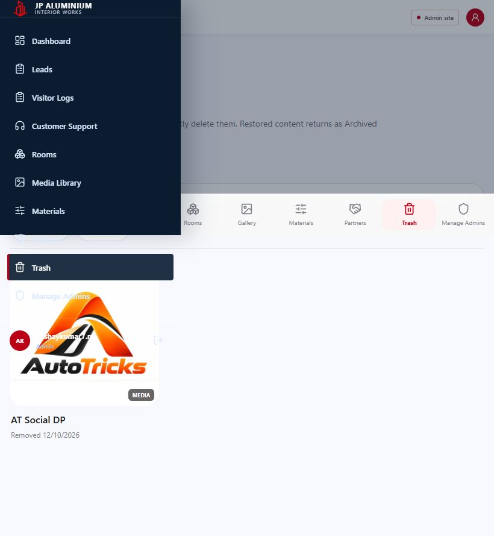
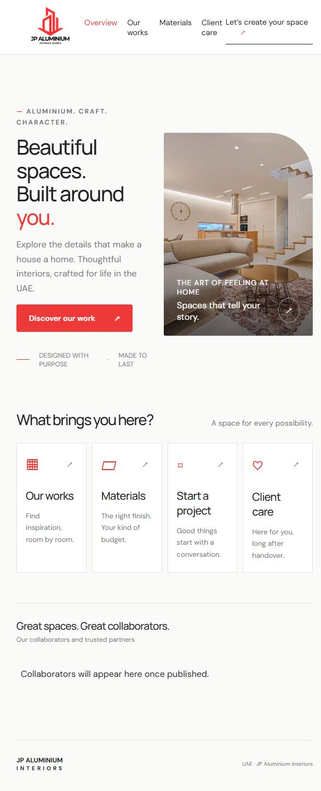

# JP admin and client responsiveness audit

Date: 13 October 2026 (IST).

What this repo does: JP admin manages rooms, works, media, materials, partners, leads, visitor logs, support records and administrator access. JP client presents the published collection and accepts visitor details, enquiries and support requests. This review assumes visitors and administrators use ordinary phones, tablets and desktop browsers; it reviews layout and UI interactions, not server load.

**Verdict: usable, but not perfectly aligned and balanced at every size. Fix the short-screen admin navigation first.** The client has no page-level horizontal overflow in the measured states, but its tablet transition and narrow form fields need improvement.

## Scope and method

- Live admin: https://jp-adminsite3.vercel.app/
- Live client: https://jp-clientsite2.vercel.app/
- Local sources: `D:/jp-aluminium/jp-adminsite` and `D:/jp-aluminium/jp-clientsite2`.
- Admin route layouts and login: 320×568, 360×800, 390×844, 430×932, 768×1024, 820×600, 844×390, 1024×768 and 1440×900.
- Client welcome, home, works, materials, enquiry and support: the same sizes plus 600×800 and 601×800 to examine the mobile breakpoint.
- Admin drawer additionally checked at 820×390. Populated work editor checked at six additional portrait/tablet/landscape/desktop sizes. Client image viewer checked at all eleven client sizes.
- Used browser screenshots, rendered element measurements, navigation, filters, dialog opening/closing and validation. Reviewed the matching local CSS/components to identify likely fixes.

Route measurements include loading states. Populated admin content was additionally inspected on a standard phone; the report does not claim that every populated data state was exercised at every size. Some full-page screenshots show fixed navigation partway through the image: that is how the browser captures fixed elements over a long page, not evidence that navigation is positioned halfway down the actual page.

## Must fix

### 1. Admin navigation runs below short screens

**What this is:** The drawer contains ten destinations and the administrator profile/sign-out area.

**Problem:** At 820×390, its visible height is 390px, while content extends to roughly 600px. Partners is partly below the viewport; Trash and Manage Admins are below it. The sidebar has `overflow-y: visible`, and opening the drawer locks body scrolling. The fixed bottom navigation also remains over the drawer.

**Fix:** Give the navigation section vertical scrolling inside the viewport, prevent the brand/profile from shrinking, and place the open drawer above the bottom navigation. Start in [styles.css](../../src/styles.css#L26), [gallery.css](../../src/gallery.css#L541), and [AppShell.tsx](../../src/components/AppShell.tsx).

**If we skip it:** Lower drawer actions remain difficult or impossible to reach through the drawer in landscape and other short windows.

## Should fix

### 2. Client switches to desktop layout too early

**What this is:** Desktop navigation, the two-column hero and four home cards all return above 600px.

**Problem:** At 601px, “Our works” and “Client care” wrap; the last navigation item touches the enquiry CTA. The hero becomes very narrow and the four category cards squeeze their titles and descriptions into several short lines. The page fits, but the spacing and balance deteriorate sharply compared with 600px.

**Fix:** Keep compact navigation and two category columns through the narrow tablet range. Give the hero its own breakpoint based on the width its copy needs. Use the existing rules in [globals.css](../../../jp-clientsite2/src/app/globals.css#L819).

**If we skip it:** Small tablets and wide phones show a cramped layout despite having more screen width than a portrait phone.

### 3. Support district and email fields stay side by side on small phones

**What this is:** Most support rows stack on mobile, but the district/email row does not.

**Problem:** At 320px, each of those fields is about 109px wide. The email placeholder is visibly cut off and longer district names cannot be read comfortably. Both still work; this is a readability problem.

**Fix:** Apply the existing `mobile-stack` class to this row in [RequestForm.tsx](../../../jp-clientsite2/src/components/RequestForm.tsx#L109).

**If we skip it:** Users must type or inspect their email in a very narrow field.

Evidence: [320px support screenshot](client-support-320.jpg).

### 4. Form text is small on phones

**What this is:** Input text inherits typography from the form labels, with an additional small rule on admin login.

**Problem:** Live admin login input text measures 12px. Live client enquiry and support input text measures 14px. These values are smaller than the surrounding body text and less comfortable to read while typing. Actual iPhone focus zoom and keyboard behaviour were not tested.

**Fix:** Set phone input/select/textarea text to 16px while retaining compact labels. Admin rule: [styles.css](../../src/styles.css#L80). Client rules: [globals.css](../../../jp-clientsite2/src/app/globals.css#L516).

**If we skip it:** Form entry remains less readable than the rest of the interface.

### 5. Lead records require excessive sideways scrolling

**What this is:** CRM records are displayed as a full desktop table in a horizontal scroll container.

**Problem:** The loaded leads table measures 1820px wide inside a 341px phone container. The page itself does not overflow, and the scroll instruction is present, but a user cannot read one complete record without moving across multiple screen widths. Customer support uses the same table implementation; its populated state was not available during this review.

**Fix:** Keep the table for desktop and show a compact record summary with expandable details on phones. Reuse the current fields and data in [CrmPage.tsx](../../src/pages/CrmPage.tsx#L69) and [cms.css](../../src/cms.css#L1552).

**If we skip it:** Mobile administrators continue moving sideways to connect a person's status, contact information and message.

Evidence: [Leads on a phone](admin-leads-390.jpg).

## Nice to have

### 6. Admin bottom navigation hides several destinations offscreen

**What this is:** Nine links are placed in a horizontally scrolling bottom bar, each at least 76px wide.

**Problem:** At 390px, only about five links fit at once. Materials, Partners, Trash and Manage Admins require sideways scrolling. Their availability is not immediately obvious; the drawer provides another path except for the short-screen problem above.

**Fix:** Keep a small set of primary destinations and add a clearly labelled More action using the existing drawer.

**If we skip it:** Less frequent destinations remain harder to discover.

Source: [gallery.css](../../src/gallery.css#L555), [AppShell.tsx](../../src/components/AppShell.tsx).

### 7. Home section heading and subtitle compete for phone width

**What this is:** “What brings you here?” and its subtitle share a horizontal row.

**Problem:** At 390px, the heading wraps over two lines and the subtitle occupies another narrow block alongside it. This looks less balanced than the other vertically arranged phone headings.

**Fix:** Stack the subtitle below the heading on phones using the existing `.section-title` rule in [globals.css](../../../jp-clientsite2/src/app/globals.css#L214).

**If we skip it:** This section keeps an awkward split heading layout.

Evidence: [Home on a phone](client-home-390.jpg).

### 8. Client viewer thumbnails shrink with collection size

**What this is:** All thumbnails share one flex row, with no explicit no-shrink or scrolling rule.

**Problem:** For the published six-image collection, thumbnails shrink from their intended 68px width to about 41px at 320px. They remain usable in this example, but additional images would squeeze them further.

**Fix:** Preserve thumbnail width and let the strip scroll horizontally. Use [globals.css](../../../jp-clientsite2/src/app/globals.css#L784).

**If we skip it:** Larger collections produce increasingly small preview targets.

### 9. Admin has a narrow-width scrollbar edge case

**What this is:** The admin body has a fixed minimum width of 320px.

**Problem:** In the tested browser at a 320px viewport, its vertical scrollbar leaves a 305px content area. Admin pages and login retain 320px width, causing a 15px horizontal scroll range. This is specific to browsers with space-consuming scrollbars; physical phones often use overlay scrollbars, so this is not a universal phone failure.

**Fix:** Remove the unnecessary body minimum width and let the existing mobile layout use the available content width. Source: [styles.css](../../src/styles.css#L19).

**If we skip it:** Very narrow windows with traditional scrollbars keep slight horizontal overflow.

## Screen and feature coverage

| Site / screen | Observed result and coverage |
|---|---|
| Admin login | Phone layout and blank-field errors checked; successful email/password sign-in verified. Google OAuth not exercised. |
| Admin overview | Populated metrics and shortcuts inspected on phone; route layout measured across nine sizes. |
| Admin leads | Populated record/table, filters, export control and pagination layout inspected. File export itself not run. |
| Admin visitor logs | Loaded cards and phone/date filters inspected; long text wraps within the layout. |
| Admin customer support | Empty state and date/export controls inspected; no populated request available. |
| Admin rooms | Four loaded room cards, room details route and works inspected; create-room dialog opened in the earlier pass. |
| Admin work editor | Existing work with two assets inspected; sticky save/cancel actions and nested media picker checked. No save, detach or reorder performed. Add-work uses the shared editor but was not separately submitted. |
| Admin media library | 24 files, search/filter/density controls, selection mode and no-3D-results state inspected. Image preview and Details pane checked at 320px. Uploads not performed. |
| Admin materials | Empty albums state and create-material editor inspected. No populated material album available. |
| Admin partners | Empty partners state and create-partner/logo editor inspected. No populated partner available. |
| Admin trash | One trashed media item and selection/type controls inspected. Restore and permanent delete not performed. |
| Admin manage admins | Loaded administrator cards and add-admin dialog inspected. Account creation, removal and password changes not performed. |
| Client welcome | Layout measured at eleven sizes; labelled test entry successfully submitted using supplied authorization. |
| Client home | Hero, four categories, footer, navigation and empty collaborator state inspected. |
| Client works | Five published works; room/media/location controls inspected. Video filtering returns two works; Chennai returns three. Empty 3D results and reset verified. |
| Client materials | Low/Mid/Top switching and empty ranges inspected. No published materials available. |
| Client enquiry | Layout, required fields and native validation inspected. No enquiry sent. |
| Client support | Layout and required-field validation inspected; choosing Email makes email required. No support request sent. |
| Client image viewer | Six-image collection, next/previous, zoom and close checked; geometry measured at eleven sizes. |
| Client video viewer | Video loaded with native controls, `playsInline`, readyState 4 and no reported media error. Full playback/seek/audio not exercised. |

## What passed

Standard phone widths (360/390/430), tablet and desktop route layouts did not produce unintended page-level horizontal overflow in the measured states. The intentional CRM table and gallery/filter strips were treated as internal scrolling, not whole-page overflow. The client pages fit even at 320px. Admin editors and the image viewer fit their checked phone sizes, and the 320px admin image viewer's four actions remained inside its dialog. Client images loaded, filter/reset transitions worked, and required form fields prevented an incomplete request from being sent.

## Not checked and practical limits

This is a browser-based responsiveness audit, not certification of every device or every possible record. Real iOS/Android keyboards, safe-area insets, pinch gestures, browser zoom, font scaling and Safari/Firefox rendering need physical-device follow-up. No populated material/partner examples, 3D assets, completed enquiry/support success states, upload/progress/failure states or destructive-action completion states were available/executed. Server error handling was inspected only where encountered; offline/slow-network failure modes were not systematically forced. Very long future titles and much larger media collections were reviewed in source where relevant, not populated into live data.

No application code, schema, Supabase project configuration, publishing state or administrator permissions were changed. The client visitor-entry audit record was the authorized data write. An initial entry attempt with an all-zero phone returned an error; a correctly formatted test entry succeeded. That isolated result is recorded as an observation, not diagnosed as a backend defect. Locally generated Next.js agent instruction files were removed after stopping local testing; saved deliverables are this report, measurements and screenshots.

Recommended implementation order: **1 → 2 → 3 → 4 → 5**, then the smaller navigation/spacing refinements. Findings can be addressed in the frontend; this report does not require using the connected Inox Supabase project.
